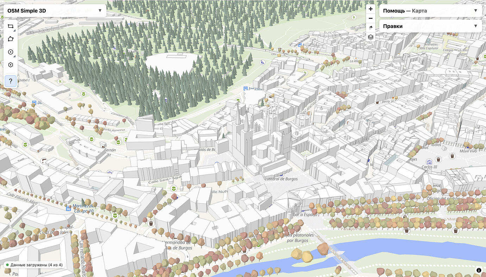
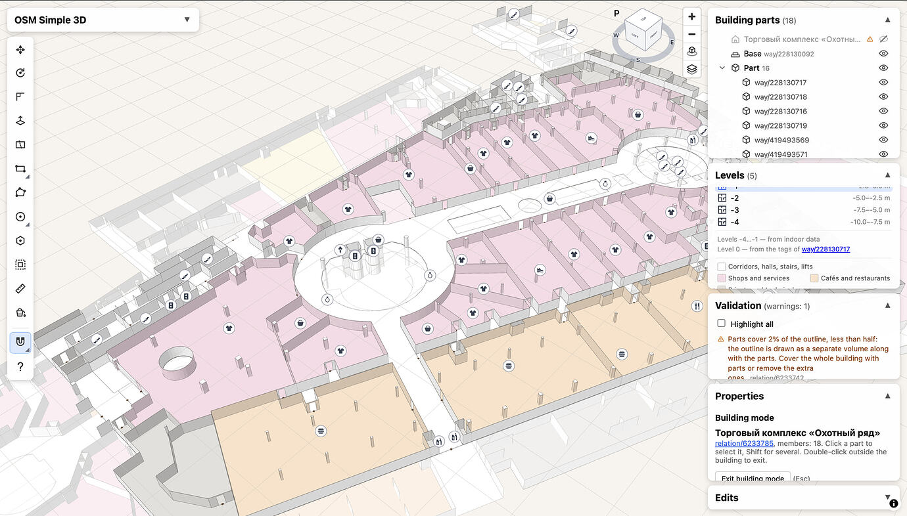

# OSM Simple 3D Editor

[English](README.md) · **Русский**

Браузерный 3D-редактор зданий для OpenStreetMap по схеме [Simple 3D Buildings](https://wiki.openstreetmap.org/wiki/Simple_3D_Buildings).
Также работает с OpenHistoricalMap и OpenGeofiction.

API OpenGeofiction может отвечать 403 на запросы из Chrome, Safari или Edge. Сейчас сервер делает исключение для IP-адресов, с которых уже редактировали OGF. Если доступ отклонён, попробуйте Firefox или обратитесь к администраторам OGF. Редактор покажет ответ сервера.

Открыть редактор: https://felispimeja.github.io/osm-simple3d-editor/

Статистика использования (чейнджсеты, пользователи, редактируемые ключи; обновляется ежедневно): https://felispimeja.github.io/osm-simple3d-stats/

## Возможности

- 3D-вид зданий и частей зданий на карте MapLibre, с крышами (плоские, шатровые, двускатные, вальмовые и другие).
- Панель тегов для `height`, `min_height`, `building:levels`, `building:min_level`, `roof:*` и цветов, с отменой/повтором и сравнением «до/после».
- Режим здания: одно здание открывается в отдельной сцене, где редактируются его части.
- Инструменты геометрии: рисование полигонов, разрезание, выдавливание и перемещение, с привязками и направляющими как в SketchUp.
- Отношения `type=building`: создание и управление участниками.
- Планы этажей по схеме [Simple Indoor Tagging](https://wiki.openstreetmap.org/wiki/Simple_Indoor_Tagging): просмотр этажей в 3D, рисование и правка помещений, коридоров, площадок, стен (линиями или, для толстых стен, полигонами с `area=yes`), колонн и дверей. Есть «Рассечь», «Объединить», «Отступ», буфер стен и трассировка по существующим контурам; этажи берутся из `level` и `repeat_on`.
- Валидатор с автоматическими исправлениями и генератор комментария к правкам.
- Подложки: спутниковые снимки и GPS-треки OSM, со смещением снимков и прозрачностью.
- Отправка через OAuth 2.0 прямо в API OSM, без своего сервера. Данные можно читать и из запущенного локально JOSM.

## Языки интерфейса

Русский и английский. Язык выбирается в панели настроек; при первом запуске — по языку браузера и системы
(русский для ru, иначе английский).

Строки интерфейса пишутся в коде по-русски через `tr('…')` / `trn(n, '…')` (см. `src/i18n/index.ts`) и служат
ключами перевода. Словари — плоские JSON в `src/i18n/locales/`: `ru.json` собирается из кода
командой `npm run i18n:extract`, а `en.json` содержит английский текст. `npm run i18n:check` проверяет, что английский текст
полный, лишних строк нет, а подстановки `{…}` совпадают. Строки с числом содержат формы через `|`
(русские — для 1, 2, 5; английские — для 1 и остальных).

Проект Transifex, настроенный в [`.tx/config`](.tx/config), использует английский как исходный язык, а русский, немецкий и французский — как целевые. Русские фразы остаются ключами JSON, а их английские значения в `en.json` служат исходным текстом для Transifex. Файл [`.tx/config`](.tx/config) связывает ресурс `Editor interface` с этими словарями. Установите [клиент Transifex](https://developers.transifex.com/docs/cli) и загрузите `TX_TOKEN` из игнорируемого `.env.local` в окружение терминала (`set -a; . ./.env.local; set +a`). После изменения строк интерфейса выполните `npm run i18n:extract`, добавьте английский текст для новых ключей в `en.json` и запустите `npm run i18n:check`. Затем отправьте английский исходник командой `tx push -s`, а созданный русский перевод — `tx push -t -l ru`. Чтобы просмотреть переводы сообщества, выполните `tx pull -t -l de,fr`, проверьте изменения в JSON и запустите `npm run i18n:check`. Не добавляйте токен в Git. Для появления немецкого или французского в редакторе также нужно подключить загруженный словарь в `src/i18n/index.ts` и дополнить список языков и обработку локали.

## Открытие из OpenStreetMap

Userscript [osm-open-simple3d.user.js](userscripts/osm-open-simple3d.user.js) добавляет пункт **Simple3D Editor** в верхнее меню openstreetmap.org сразу после **About** («О проекте»). Установите файл в Tampermonkey или другой менеджер userscript-скриптов. С главной страницы он открывает редактор в новой вкладке с текущим центром и масштабом карты; со страницы линии или отношения — по ссылке на сам объект (`?edit=w123` / `?edit=r456`). Со страницы узла передаётся текущий вид карты. Пункт работает и при переходах между страницами без перезагрузки.

## Открытие из OSMCha

Userscript [osmcha-open-simple3d.user.js](userscripts/osmcha-open-simple3d.user.js) добавляет пункт **Simple3D Editor** в меню **Open with** на странице чейнджсета OSMCha. Установите файл в Tampermonkey или другой менеджер userscript-скриптов и разрешите запросы к `api.openstreetmap.org`. Скрипт берёт границы чейнджсета из OSM API и открывает редактор по ссылке вида `#масштаб/широта/долгота`. Если у чейнджсета нет границ, пункт сообщает, что местоположение недоступно. На [OSMCha OpenHistoricalMap](https://osmcha.openhistoricalmap.org) скрипт берёт границы из API OHM (разрешите запросы к `www.openhistoricalmap.org`) и открывает редактор с сервером OHM (`?server=ohm`) на дату, когда существует больше всего изменённых объектов (по `start_date`/`end_date`, в первую очередь зданий; `&date=`), — чтобы правки были видны.

## Открытие из F4map и indoor=

Userscript-скрипты [f4map-open-simple3d.user.js](userscripts/f4map-open-simple3d.user.js) и [indoorequal-open-simple3d.user.js](userscripts/indoorequal-open-simple3d.user.js) добавляют кнопку **Simple3D Editor** в левый нижний угол [F4map](https://demo.f4map.com) и [indoor=](https://indoorequal.org). Кнопка открывает редактор в новой вкладке с текущим центром и масштабом карты (`#масштаб/широта/долгота`); из F4map передаются также поворот и наклон камеры (`#масштаб/широта/долгота/азимут/наклон`). Этаж из indoor= не передаётся: редактор открывает этаж только вместе со зданием (`?edit=`).

## Использование ИИ

Проект разрабатывается с помощью ИИ. Бо́льшая часть кода, документации и переводов написана с [Claude](https://claude.ai/) (Anthropic) через Claude Code под руководством сопровождающего проекта, который ставит задачи, проверяет и тестирует изменения и отвечает за каждый коммит. Коммиты, сделанные с участием ИИ, содержат строку `Co-authored-by: Claude <noreply@anthropic.com>`.

Правки, загружаемые этим редактором в OpenStreetMap и другие картографические проекты, делают люди; сам редактор картографических данных не создаёт.

## Лицензия

Код распространяется по лицензии [ISC](LICENSE). Данные карты — по лицензиям соответствующих проектов
(ODbL у OpenStreetMap и OpenHistoricalMap, своя у OpenGeofiction).
