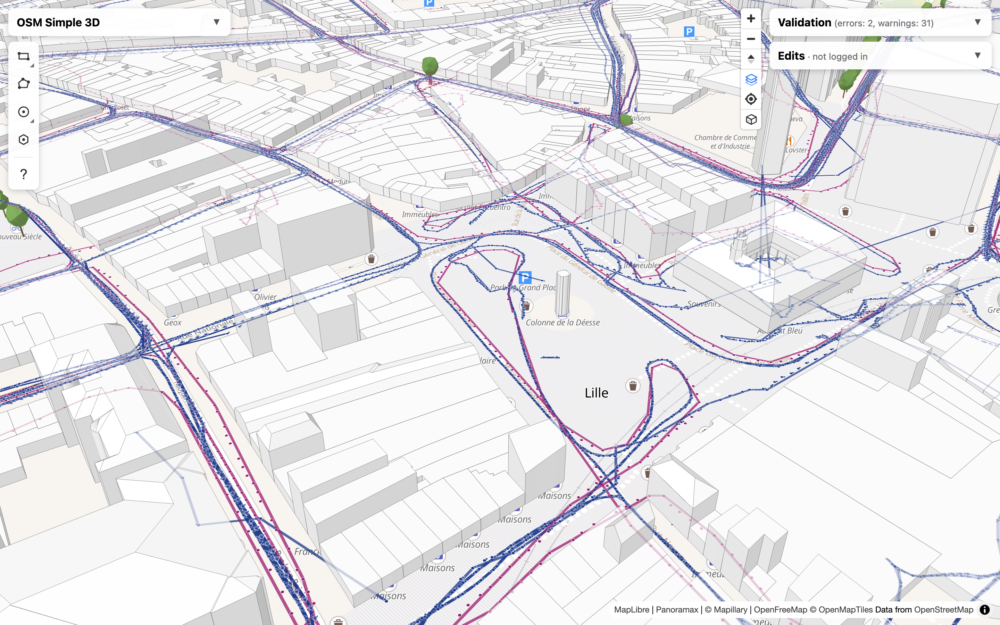
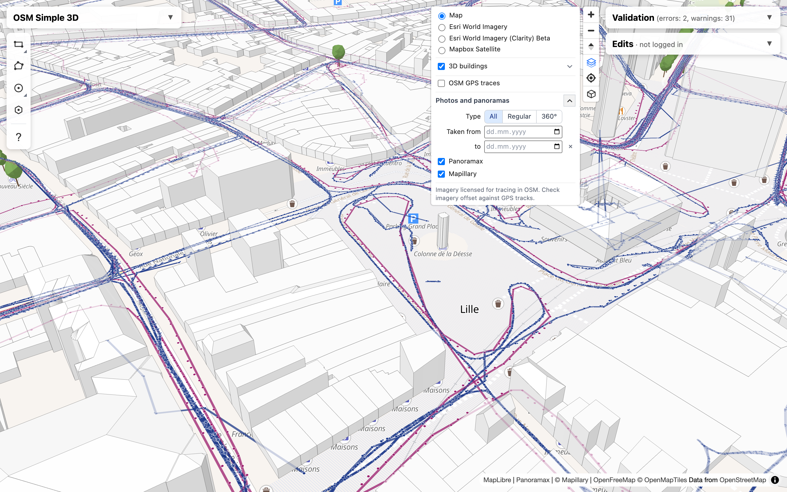
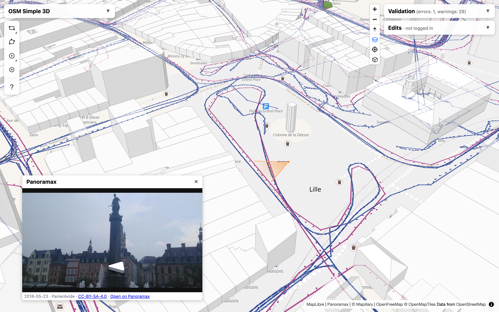
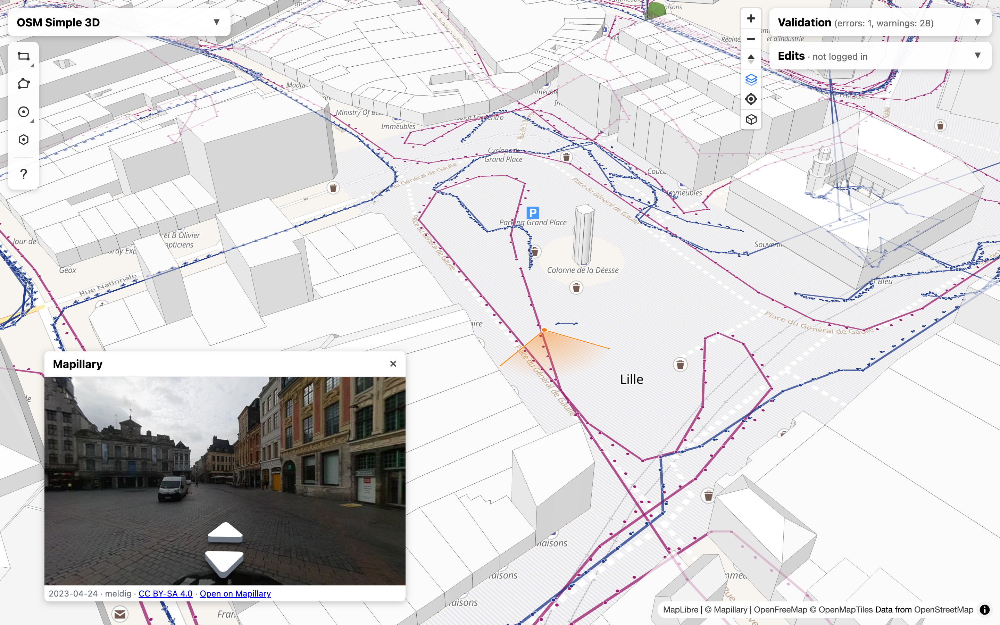
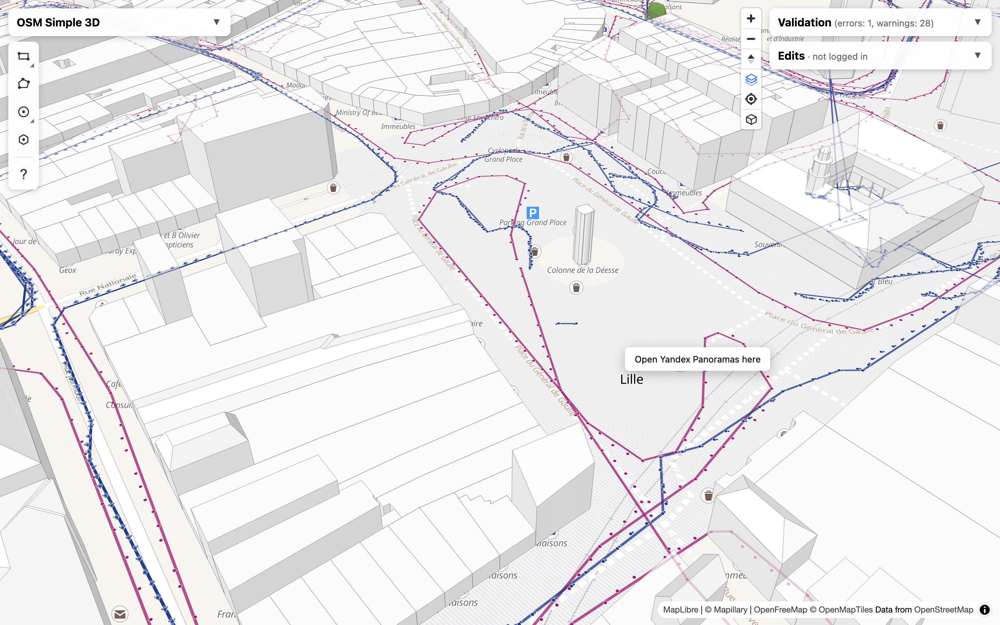

# OSM Simple 3D: Panoramax and Mapillary street-level photos right in the 3D editor

Hi everyone! [OSM Simple 3D](https://felispimeja.github.io/osm-simple3d-editor/), a browser-based 3D building editor for OpenStreetMap, now supports street-level photos and panoramas. You can check heights, levels, roof shapes and facade details against imagery without leaving the editor.

## What's new

**Two open sources: Panoramax and Mapillary.** Both are allowed for mapping in OSM (Panoramax: CC BY-SA / etalab-2.0, Mapillary: CC BY-SA 4.0). Capture sequences and photo points are drawn on the map; at low zooms you get a coverage grid or overview dots.

**Sequences don't clash with buildings.** Tracks and photo points are hidden behind 3D buildings, with only a faint "ghost" showing through the walls. You can still see where imagery exists, but the map doesn't turn into a mess.

**A shared "Photos and panoramas" group in the layers menu.** Toggle each service and use common filters: photo type (All / Regular / 360°) and capture date range. Colour tells 360° panoramas apart from regular photos.

**One viewer for both services.** Click a point to open the photo. The map shows the camera position and a view cone that turns as you look around a panorama. Arrows step forward and back along the sequence. The caption shows the date, author, licence and a link to the photo on the service's website. The viewer is independent of the layers: close it and the layers stay on; turn a layer off and its photo closes.

**Yandex Panoramas via right-click.** The map's context menu has an "Open Yandex Panoramas here" item. It opens Yandex Maps at the nearest panorama, facing the same direction as the map. Yandex's terms don't allow embedding their panoramas into third-party maps (clause 6.1.1 of the API terms), so it's a link only. Reminder: under the [permission obtained by the Russian community](https://wiki.openstreetmap.org/wiki/RU:ВикиПроект_Россия/Яндекс.Панорамы), you may only trace what is visible in the photos, without Yandex's georeferencing or data.

**Sources in the changeset.** On upload the editor fills in `imagery_used` and `source` automatically: the aerial imagery that was on (`aerial imagery`) and the services whose photos you actually opened (`streetlevel imagery`). Merely having a photo layer turned on doesn't count as a source.

## Also in the layers menu

- Raster imagery settings now unfold right in the menu: opacity, north/east offset, a drag-to-shift tool button and reset.
- The menu no longer jumps in width when you switch settings.

## Try it

Open the [editor](https://felispimeja.github.io/osm-simple3d-editor/), click the layers button on the right and enable Panoramax and/or Mapillary in the "Photos and panoramas" group. Feedback, bug reports and ideas are very welcome, here or in [GitHub issues](https://github.com/FelisPimeja/osm-simple3d-editor/issues).

And please consider capturing and uploading your own photos to [Panoramax](https://panoramax.xyz), an open, federated alternative that could use a lot more coverage.
